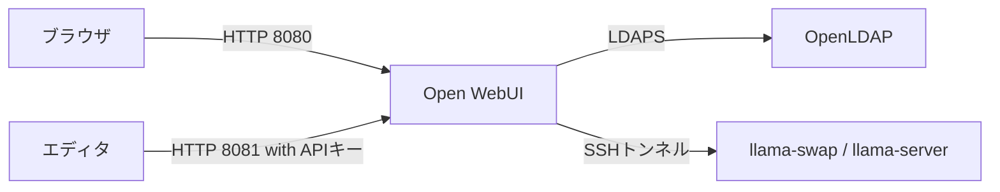

# LLMインフラ例

研究室メンバーにローカルLLMを提供することを想定した環境例を提示しています。
OpenLDAPによる認証基盤、Open WebUIでのリクエスト窓口、llama-swap+llama-serverでの推論で
構成しています。

| VM | 役割 | IP |
| --- | --- | --- |
| `ldap` | OpenLDAP(LDAPS) | `192.168.76.10` |
| `webui` | Open WebUI | `192.168.76.20` |
| `llm` | llama-swap＋llama-server | `192.168.76.30` |



## 実機や自身の環境への適用

`ansible` ディレクトリの内容を実機または自身で準備された環境へ反映させたい場合、
以下の手順で準備いただければスムーズに適用できます。

* サーバ: 3台のUbuntu Server 26.04
* 接続先: `inventory.yml` の `ansible_host` を実際のIPアドレスへ変更
* コンテナネットワーク: `10.89.76.0/24` が重複しないこと
* `precheck.yml` の修正

## NixOS内のVMへの適用

NixOSの場合は、ホストに以下の設定を追加することで `nix run .#vm-init/vm-up/ansible-apply/vm-down` などが利用できます。
以下の設定では、`<ADMIN_USER>`と`<VM_USER>`を実際にIncusの権限を与えるユーザ名に置き換えてください。以降も`<...>`は置き換え対象を表し、山括弧ごと実際の値へ置き換えます。

```nix
{
  virtualisation.incus.enable = true;
  networking.nftables.enable = true;
  networking.nftables.flushRuleset = false;
  networking.firewall.interfaces.llmbr0 = {
    allowedTCPPorts = [ 53 ];
    allowedUDPPorts = [ 53 67 ];
  };
  users.users.<ADMIN_USER>.extraGroups = [ "incus-admin" ];
  users.users.<VM_USER>.extraGroups = [ "incus" ];
}
```

### 事前準備

`incus-admin` グループのユーザで必要なリソースを作成します。

```bash
nix run .#vm-init
```

一般ユーザで以下を実行することで、Incus側にユーザ用の必要リソースが自動作成されます。

```bash
nix develop -c incus info local:
```

管理ユーザで一般ユーザのUIDと証明書一覧を確認します。`<VM_USER>`は一般ユーザ名に置き換えてください。

```bash
id -u <VM_USER>
nix develop -c incus config trust list local: -c nFrp
```

`id -u <VM_USER>` で確認したUIDを使い、
証明書一覧から名前が `incus-user-<UID>` の行を探してください。
その行のフィンガープリントで、次のコマンドの `<FINGERPRINT>` を置き換えて実行してください。

```bash
nix develop -c incus config trust edit local:<FINGERPRINT>
```

上記コマンドを実行するとエディタが開くため、
`restricted: true`と既存の`projects`を保持し、
`projects`へ`llm-lab`を追加してください。
これで一般ユーザから検証用プロジェクトを操作できます。

### 起動と動作確認

一般ユーザでVMを起動し、Ansibleを適用します。

```bash
nix run .#vm-up
nix run .#ansible-apply

# 適用後の動作確認
nix run .#ansible-postcheck

# 立ち上げたVMへは、例えば以下でSSH接続が可能
nix run .#vm-ssh -- ldap
```

### Open WebUIの利用

LDAPユーザ `demo` が作成されているため、
このユーザでOpen WebUIが `http://192.168.76.20:8080` からアクセスできます。
`demo` のパスワードは以下で取得できます。

```bash
nix develop -c nu --no-config-file -c 'open .state/secrets.json | get ldap_demo_password'
```

エディタなどからAPIを利用する場合は、次を指定します。

| 項目 | 値 |
| --- | --- |
| Base URL | `http://192.168.76.20:8081/v1` |
| APIキー | Open WebUIの設定画面で発行したAPIキー |
| モデル | `qwen3-0.6b` |

### 停止と削除

VMの停止は `nix run .#vm-down` でできます。
停止してもディスクは残ります。

### VMのみの削除

一般ユーザで停止した後、管理ユーザで削除します。
VM内のデータとスナップショットも削除されます。

```bash
nix develop -c incus delete local:ldap local:webui local:llm --project llm-lab
```

作り直す場合は一般ユーザで `rm -f .state/known_hosts` で古いSSHホスト鍵の記録を削除してから
以下のコマンドで作成と設定適用を行ってください。 `.state/secrets.json` は再利用できます。

```bash
nix run .#vm-up
nix run .#ansible-apply
```

### 基盤を含む削除

管理ユーザで `nix develop -c incus config trust edit local:<FINGERPRINT>` を実行してエディタを開き、
`projects` 一覧から `llm-lab` 行だけを削除してください。
`<FINGERPRINT>` は対象のフィンガープリントに置き換えてください。

続いて管理ユーザで `nix run .#vm-clean -- --force` で基盤リソースを削除します。

`.state` 以下は残っているので `rm -r .state` で削除してください。

### VM時の保存データ

| ファイル | 内容 |
| --- | --- |
| `.state/secrets.json` | LDAPパスワード・WebUI秘密値（初回の`ansible-apply`で生成） |
| `.state/known_hosts` | SSH接続先のホスト公開鍵 |
| `.state/vm.lock` | 起動・停止の同時実行を防ぐロック |

## 注意点

- [vms/cloud-init/](vms/cloud-init/)の各YAMLにKeishiSの公開鍵を登録済みです。参考にする場合は書き換えてください。
